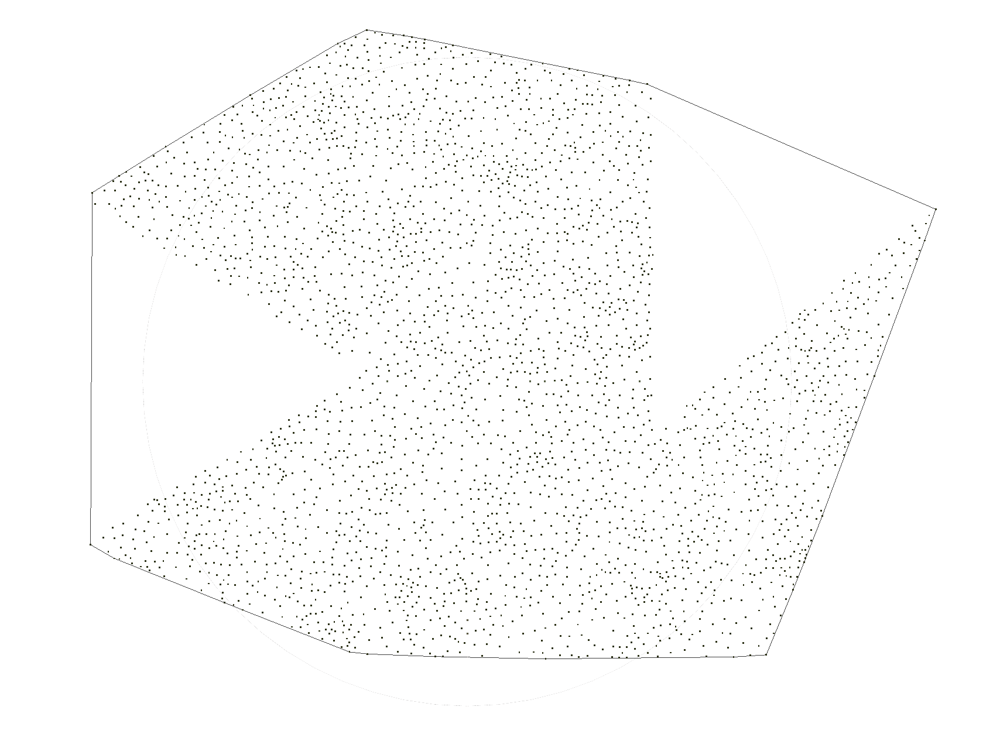
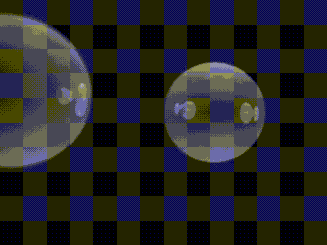
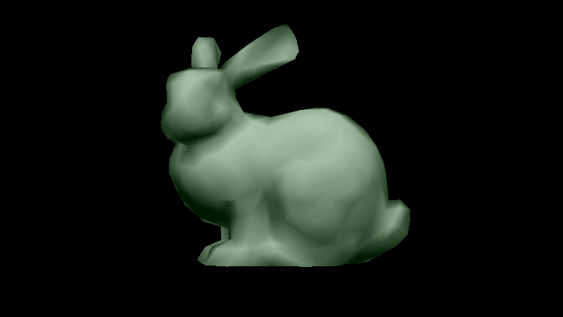

# NYU Coursework (2021)

Labs, homeworks and projects from four computer science courses I took at NYU in 2021.

| Course | Term | Language | Highlights |
| --- | --- | --- | --- |
| [Deep Learning](deep-learning/) | Spring 2021 | Python, PyTorch | MLP from scratch, CNN / RNN, energy-based models, MoCo self-supervised final project |
| [Operating Systems](operating-systems/) | Spring 2021 | C++ | Two-pass linker, process scheduler, MMU / page replacement, I/O scheduler |
| [Computer Graphics](computer-graphics/) | Fall 2021 | C++, Eigen | Convex hull, ray tracing, AABB trees, software rasterization, interactive 2D editor |
| [Artificial Intelligence](artificial-intelligence/) | Fall 2021 | C++ | BFS / IDDFS / A* search, CNF conversion + DPLL, MDP solver, kNN and k-means |

## Gallery

| Convex hull | Ray tracing | AABB tree | Rasterization |
| :---: | :---: | :---: | :---: |
|  |  |  |  |

## Repository layout

```
.
├── deep-learning/            # Spring 2021: hw1–hw3, final project
├── operating-systems/        # Spring 2021: lab1–lab4, lab specs in pdf/
├── computer-graphics/        # Fall 2021: Assignment_1–Assignment_6
└── artificial-intelligence/  # Fall 2021: lab1–lab4
```

Each course folder has its own README with build and run instructions. Most assignments also include a `REPORT.md` or `README.md` describing the approach.

## History

This repository merges four repositories that used to be separate. Each course's full commit history is kept under its folder (`git log -- <folder>`), and the original final state of each repository is tagged:

| Tag | Original repository |
| --- | --- |
| `dl-21-spring` | `changtk07/dl-21-spring` |
| `os-21-spring` | `changtk07/os-21-spring` |
| `cg-21-fall` | `changtk07/cg-21-fall` |
| `ai-21-fall` | `changtk07/ai-21-fall` |

## Academic integrity

This code is shared for reference and as a portfolio. **If you are currently taking any of these courses, do not copy or submit any part of this code.** Doing so violates NYU's academic integrity policy.

Some folders contain starter code, assignment specs, sample inputs or grading scripts provided by the course staff, and those materials belong to their original authors. The Deep Learning final project builds on [facebookresearch/moco](https://github.com/facebookresearch/moco).
